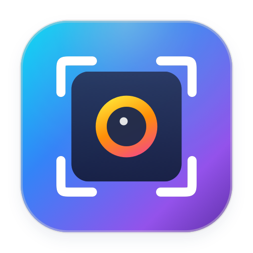

<p align="center">
  
</p>

<h1 align="center">SuperShot</h1>

<p align="center">
  <strong>Ultra-lightweight, Lightning-Fast Native macOS Screenshot &amp; In-Place Annotation Tool</strong><br>
  <em>Swift &bull; SwiftUI &bull; Lightshot-Style Overlay &bull; Vector Annotations &bull; Universal 2 &bull; Multi-language Support</em>
</p>

<p align="center">
  <a href="#english">English</a> &bull; <a href="#tiếng-việt">Tiếng Việt</a>
</p>

<p align="center">
  <a href="https://github.com/nhanqv-ai/SuperShot/releases"></a>
  <a href="https://github.com/nhanqv-ai/SuperShot/releases/tag/v1.0.25"></a>
  <a href="LICENSE"></a>
  
  
  
</p>

---

<a name="english"></a>
## English

**SuperShot** is an ultra-lightweight, native macOS menu bar screenshot and annotation tool built with Swift, AppKit, and SwiftUI. Inspired by the speed of **Lightshot** and the menu bar workflow of **SuperClip**, it freezes your screen instantly on shortcut trigger (`Option + S`), lets you drag and resize a selection region, and provides floating toolbars right beside your selection for object-based shapes, text, arrows, freehand drawing, and pixelation blur before copying or saving.

### Highlights

- **Lightshot-Style In-Place Screen Overlay**: Pressing `Option + S` (customizable) immediately freezes the screen at full Retina (`2x`) resolution and dims the surrounding area. Drag to select any region, adjust using 8 resize handles, and see live `W x H px` dimensions.
- **Object-Based Vector Annotations (Select, Move, Edit & Undo/Redo)**:
  - **Shapes & Pointers**: Rectangle (`rectangle`), Ellipse/Circle (`circle`), Arrow (`arrow.up.right`), and Straight Line (`line.diagonal`).
  - **Freehand & Highlighter**: Smooth Pen (`pencil.tip`) and semi-transparent Highlighter Marker (`highlighter`).
  - **In-Place Editable Text**: Click anywhere inside the capture region to type text (`textformat`), double-click to edit existing text, drag to reposition, or change color and font size on the fly.
  - **Sensitive Region Blur / Pixelate**: Drag over passwords, tokens, or personal data (`checkerboard.rectangle`) to pixelate/blur them cleanly.
  - **Interactive Object Manipulation**: Select any drawn shape, arrow, or text box to move, resize, recolor, adjust stroke width, or delete (`Delete` / `Backspace`), backed by full `Cmd + Z` / `Cmd + Shift + Z` Undo/Redo stacks.
- **Smart Edge-Aware Toolbars**:
  - **Vertical Annotation Toolbar**: Anchored along the right edge of the selection box (auto-flips to the left or inside when near screen boundaries).
  - **Horizontal Action Toolbar**: Anchored along the bottom edge for 1-click **Copy** (`Cmd + C` / `Return`), **Save** (`Cmd + S`), **macOS Share Sheet**, and **Cancel** (`Esc`).
- **Scrolling Screenshot for Long Content (Webpages, Documents, Code)**:
  - Full-page capture extending beyond screen borders with automatic scroll wheel synthesis (`CGEvent`) or manual scrolling.
  - Stationary **Sticky Header & Footer Deduplication** so navigation headers are not repeated mid-stitch.
  - Automatic right-edge **Scrollbar Strip Exclusion** during overlap matching.
  - Real-time **Live Stitched Preview** with running dimensions and frame counts.
  - Multi-page **Scrollable Annotation Canvas** for full vector annotations on long captures before saving or copying.
- **Color Preset System (`ColorPreset` & `ColorPalettePopoverView`)**:
  - Preloaded with 8 standard high-contrast colors for instant 1-click swatch recoloring.
  - Custom HEX (`#RRGGBB`) color input and screen Eyedropper sampling tool.
  - Favorite presets shelf storing up to 16 custom colors with right-click deletion.
  - Automatic persistence of last-used color, stroke width, and font size across capture sessions.
- **Menu Bar Screenshot History & Direct Auto-Paste (SuperClip Style)**:
  - Left-clicking the menu bar icon opens the **Screenshot History Popover** with Pinned & Recent sections, instant search, hover zoom preview (`ThumbnailHoverPreviewPanel`), quick `1..9` keyboard selection, and Direct Auto-Paste (`Cmd + V` simulation).
  - Each history row provides quick actions to **Copy**, **Save to File**, **Pin/Unpin**, and **Delete**.
- **Flexible Save Modes**: Configure `Cmd + S` to either prompt with the native `NSSavePanel` or save instantaneously into a default folder (e.g. `~/Desktop` or `~/Pictures/SuperShot`) in `PNG` or `JPEG` format.
- **Universal 2 Architecture**: Compiled as a native fat Mach-O binary supporting both Apple Silicon (`arm64`: M1/M2/M3/M4) and Intel (`x86_64`: MacBook Pro 2020 and earlier) on macOS 13.0 (Ventura) and macOS 14.6+ (Sonoma).
- **Multi-Language Support**: Full dynamic runtime translation without restarting: English, Vietnamese (Tiếng Việt), Simplified Chinese (简体中文), Japanese (日本語), Korean (한국어), Spanish (Español), French (Français), German (Deutsch), and System Default.
- **Zero Emojis Invariant**: Crisp typography and native SF Symbols throughout the entire application.

### Keyboard Shortcuts

| Shortcut | Action | Scope |
| :--- | :--- | :--- |
| `Option + S` | Trigger instant screen capture overlay (customizable) | Global |
| `Option + Shift + S` | Trigger scrolling capture overlay for long content (customizable) | Global |
| `Command + C` or `Return` | Copy annotated screenshot to clipboard & save to history | Capture Overlay |
| `Command + S` | Save annotated screenshot to file (`PNG` / `JPEG`) | Capture Overlay |
| `Return` or `Space` | Finish scrolling capture and open annotation canvas | Scrolling Capture |
| `Command + Z` | Undo last annotation action | Capture Overlay |
| `Command + Shift + Z` | Redo annotation action | Capture Overlay |
| `Command + D` | Duplicate currently selected annotation object | Capture Overlay |
| `Shift` (Hold) | Constrain rectangle to square, ellipse to circle, line/arrow to 45 deg | Capture Overlay |
| `Delete / Backspace` | Delete currently selected annotation object | Capture Overlay |
| `Escape` | Cancel capture overlay or dismiss history popover | Overlay / Panel |
| `1` .. `9` or `Cmd + 1` .. `Cmd + 9` | Directly copy & auto-paste screenshot 1 to 9 | History Popover |
| `Up / Down Arrow` | Circular navigation across screenshot history | History Popover |
| `Command + ,` | Open Preferences window | History Popover / Menu |
| `Command + Q` | Quit SuperShot | History Popover / Menu |

### User Guide: Scrolling Screenshot for Long Content

SuperShot seamlessly captures content that extends beyond the visible screen, such as long web pages, PDF documents, source code listings, terminal scrollbacks, or chat transcripts:

1. **Trigger Scrolling Capture**:
   - Press the global shortcut `Option + Shift + S` (or click **Scrolling Screenshot** in the menu bar context menu or the scroll icon on the selection toolbar).
   - Drag to select the target scrollable window or content area.
2. **Auto-Scroll vs Manual Scroll**:
   - **Auto-Scroll**: Click the **Start Scrolling** button. SuperShot automatically synthesizes smooth downward scroll wheel events (`CGEvent`), dynamically adapting scroll speed and frame intervals.
   - **Manual Scroll**: Toggle to manual mode if you prefer to scroll at your own pace using your mouse wheel, trackpad, or keyboard arrow keys.
3. **Intelligent Stitching Engine**:
   - **Sticky Header & Footer Deduplication**: Automatically detects fixed navigation bars, sticky headers, and floating footers, preserving them cleanly at the edges without duplicating them mid-stitch.
   - **Scrollbar Strip Exclusion**: Excludes the right-side vertical scrollbar strip during overlap matching to prevent stitching seams and artifacts.
   - **Live Stitched Preview**: Displays a real-time thumbnail preview and running pixel dimensions (`W x H px`) next to the capture region as new segments are stitched.
   - **Auto-Stop Detection**: Intelligently halts when the bottom of the page is detected, when `maxScrollHeightPx` is reached (configurable from `5,000 px` to `30,000 px` in Settings, default `15,000 px`), or when you press `Return`, `Space`, or click **Finish**.
4. **Scrollable Vector Annotation Canvas**:
   - Upon completion, the tall stitched image opens in the full-height scrollable canvas.
   - Pan and scroll smoothly through the tall canvas while adding any vector annotations (rectangles, circles, arrows, lines, text, highlighters, pen strokes, and sensitive blur/pixelation).
   - Click **Copy** (`Cmd + C`) or **Save** (`Cmd + S`) to finalize.

### User Guide: Color Presets & Palette System

SuperShot provides a fast, flexible color management system for all vector annotation tools:

1. **Toolbar Color Swatch**:
   - The active drawing color is displayed in the circular swatch on the vertical annotation toolbar.
   - Clicking the swatch opens the `ColorPalettePopoverView`.
2. **8 High-Contrast Default Swatches**:
   - Pre-loaded with 8 carefully tuned, high-contrast colors: Red (`#FF3B30`), Orange (`#FF9500`), Yellow (`#FFCC00`), Green (`#34C759`), Mint (`#00C7BE`), Blue (`#007AFF`), Purple (`#AF52DE`), and Dark Slate (`#1C1C1E`).
   - Clicking any swatch instantly changes the active tool's color or updates the selected object on the canvas.
3. **Custom Hex Input & Screen Eyedropper**:
   - **HEX Code Input**: Enter any custom 6-digit hex color code (`#RRGGBB`) directly into the text field.
   - **Screen Eyedropper**: Click the eyedropper icon to sample any pixel color directly from your macOS screen.
4. **Save Up to 16 Favorite Presets**:
   - Click the `+` button in the palette popover to save your current custom color into your personal presets (up to 16 presets stored).
   - Manage presets directly: right-click to delete a preset, or reset presets to factory defaults in **Preferences** -> **Capture & Save**.
5. **Session State Persistence**:
   - SuperShot automatically persists your selected color, stroke width, and font size across captures, so your preferred styling is ready every time you press `Option + S`.

### What's New in v1.0.25

- **Pixel-Exact Image Crop & Offset Alignment**: Fixed a latent vertical rendering bug in `ImageRenderer.render` where background imagery shifted relative to vector annotations when `cropRect != nil`, guaranteeing exact coordinate parity across scales.
- **Multi-Display Coordinate Mapping**: Hardened `ScrollingCoordinateMapper` to resolve absolute screen coordinates across primary, secondary, and negative-origin display configurations (`cgBounds` vs `cocoaFrame`).
- **Typography Baseline & Layout Parity**: Synchronized CoreText font rendering across `SelectionBoxView`, `ScrollableCanvasView`, and `ImageRenderer` with dynamic bounding box expansion and zero-bleed vertical alignment.
- **Blur Region Clamping & Anti-Bleed Guarantees**: Enforced strict CIImage extent clamping in pixelation filters, preventing edge sample bleed and darkening at frame boundaries.
- **Inverted Handle Resizing with Geometric Mirroring**: Enhanced pen and highlighter vector annotations to cleanly mirror control points across axes when dragged past opposite resize handles without collapsing or zero-width crashes.
- **Concurrency & Lifecycle Leak Prevention**: Fortified timer invalidation in `UpdateManager` with deinit safety and guaranteed rapid task cancellation during auto-paste operations in `MainShotView`.
- **Pixel-Accurate Synthetic Image Regression Test Suite**: Comprehensive automated test coverage (`Cycle18Tests.swift`) utilizing 4-quadrant, banded, and high-frequency checkerboard synthetic images to verify zero-pixel drift.

### What's New in v1.0.24

- **Interactive Quick Copy Action Pill on Selection Box**: Clickable `[ doc.on.doc Copy ]` pill attached adjacent to the live dimension badge with `pointingHand` cursor, visual hover highlight, and 1-click clipboard copy.
- **Spacebar Selection Repositioning (`Space + Drag`)**: Holding the Spacebar while dragging freezes the active selection dimensions and pans the selection box origin smoothly.
- **Text Annotation Font Size Stepping (`[` / `]`) & HUD Pill**: Dedicated bracket keys step text font size (10pt–72pt) for active text annotations with real-time `Font Size: X pt` HUD pill feedback.
- **Tall Canvas "Fit to Window" Zoom Action**: Replaced redundant zoom button with dedicated "Fit to Window" button (`rectangle.inset.filled`) in `ScrollableCanvasView` for instant full-document overview.
- **Visual Hover Affordance on Dimension & Quick Copy Pills**: Subtle accent border and fill highlight on mouse hover matching `pointingHand` cursor feedback on all floating pills.
- **Direct History Keyboard Shortcuts (`⌘⇧C` & `⌥⌘C`)**: Dedicated keyboard shortcuts to Copy File Path (`Cmd+Shift+C`) and Copy Dimensions (`Cmd+Option+C`) directly in `MainShotView` with transient HUD notifications.
- **Tall Canvas Double-Click Quick Copy Parity**: Double-clicking an empty area in `ScrollableCanvasView` copies the complete stitched image to clipboard and closes the window.
- **Screen Boundary Collision Avoidance**: 5-tier placement cascade prevents dimension badge and quick copy pill overlap with the horizontal action toolbar near display edges.
- **Zero-Emoji 9-Language Localization Completeness**: Comprehensive localized strings for quick copy, font size HUD, fit window tooltip, and copy notifications across all 9 supported languages.

### What's New in v1.0.23

- **Update Download Cancellation & Abort Recovery**: Retain active download task with immediate cancellation via dedicated `cancelDownload()` method in `UpdateManager`, featuring cancellation buttons (`xmark.circle`) in both the About settings tab and the History Popover update banner.
- **Determinate Linear Progress Bar in About Tab**: Replaced indeterminate spinner with a sleek determinate `ProgressView` and percentage readout during update asset downloads.
- **In-App Release Notes Viewer Sheet**: Added a native macOS sheet view (`ReleaseNotesSheetView`) allowing users to read full markdown release notes directly inside SuperShot before upgrading.
- **Update Error Reporting with Inline Retry Action**: Visual warning indicator, complete error tooltip, and direct "Retry" action button (`arrow.clockwise`) on check or download failures.
- **Last Checked Timestamp Caption in About Tab**: Displays relative time caption (`Last checked: ...`) below the Check for Updates action across all 9 supported languages.
- **Double-Click Selection to Quick-Copy & Dismiss**: Double-clicking inside an active selection rectangle instantly copies the region to the clipboard with HUD feedback and dismisses the overlay.
- **Interactive Dimension Badge Click-to-Copy**: Hovering the live dimension badge displays a pointing-hand cursor, and clicking immediately copies dimension string (`W x H px`) to the clipboard with confirmation HUD.
- **Positional Index & Total Count in Object Cycling HUD**: Keyboard cycling (`Tab` / `Shift+Tab`) provides enhanced HUD feedback including tool name, 1-based index, total objects, and shortcut mnemonic (e.g., `Arrow 2/4 (A)`).
- **History Context Menu Enhancements**: Added "Copy File Path" (`link`) and "Copy Dimensions" (`aspectratio`) actions to history item context menus.
- **Keyboard Nudge & Resize HUD Pill Feedback**: Real-time transient HUD pills confirm arrow-key nudging (`Nudge (1pt)` / `Nudge (10pt)`) and `Option + Arrow` dimension resizing (`W x H px`).
- **Search Filter Empty State Quick Reset Button**: Added a 1-click "Clear Search" reset button (`xmark.circle`) when history search filters return 0 matching items.

### What's New in v1.0.22

- **Enhanced UpdateManager with DMG & Streaming Progress**: Comprehensive GitHub Releases update engine supporting automatic discovery and mounting of `.dmg` distributions via `hdiutil`, byte-level streaming progress reporting (`URLSessionDownloadDelegate`), dynamic non-admin user staging, and clean quarantine removal (`com.apple.quarantine`).
- **Safe Application Relaunch & Fallback Guard**: Stage-and-relaunch mechanism powered by `NSWorkspace.shared.openApplication` with a 3.0s fallback timer ensuring seamless updates without hung processes.
- **About Tab Status & Visual Checkmark Polish**: Resolved duplicate status text and button labels to distinct `.updateReadyRestart` and `.restart` strings, accompanied by a downloading progress indicator and a green `checkmark.circle.fill` badge when up to date.
- **Annotation Deletion HUD Pill (`.hudDelete`) across 9 Languages**: Visual confirmation HUD pill displaying "Deleted (⌫)" appears instantly upon deleting vector objects via Delete/Backspace across English, Vietnamese, German, French, Spanish, Japanese, Simplified Chinese, Traditional Chinese, and Korean.
- **Keyboard Vector Selection Cycling (`Tab` / `Shift+Tab`)**: Cycle forwards (`Tab`) and backwards (`Shift+Tab`) through active vector annotations with real-time HUD tool mnemonic and name feedback.
- **History Popover Context Menu SF Symbols Modernization**: Native `Label(title, systemImage: icon)` integration with 100% SF Symbols and zero emojis.
- **Safe Browser Fallback on Asset-less Releases**: Gracefully opens GitHub release page in the default web browser when binary assets are not attached.

### What's New in v1.0.21

- **Native Drag-and-Drop for History Rows (`.onDrag`)**: Drag past screenshots directly out of the history popover into Slack, Discord, Mail, Safari, Keynote, or Finder folders.
- **Re-Annotate Keyboard Shortcut (`⌘⇧A`) & Context Menu Parity**: Press `Cmd+Shift+A` (`⌘⇧A`) on any selected history item to immediately open it in the vector annotation editor.
- **Perceptible Keyboard Copy HUD Confirmation Delay**: Pressing Return or `Cmd+C` in the capture overlay now defers dismissal by 180ms so the `Copied to Clipboard` HUD pill is perceived.
- **Vector Canvas Mutation HUD Feedback**: Real-time HUD pills confirm Undo (`⌘Z`), Redo (`⌘⇧Z`), and Duplicate (`⌘D`) across both in-place overlay and tall canvas viewports.
- **Adaptive Popover Footer Shortcut Hint**: Dynamically updates the footer bar to display `⌥1-9: Pinned · 1-9: Recent` with a `keyboard` icon whenever pinned items are present.
- **Welcome Window Safe Area Bleed & Permission Deep Linking**: Adds `.ignoresSafeArea()` eliminating window titlebar gaps, and direct links into macOS System Settings when permissions are requested.
- **Hex Input Return-Key Preset Creation (`.onSubmit`)**: Pressing Return in hex input fields creates presets instantly; preview swatch features a subtle `paintpalette` placeholder when empty.
- **VoiceOver Accessibility Role & Traits in Settings**: Declares native `.tab` role and `.isSelected` traits on `SettingsTabButton` for assistive technology navigation.
- **Complete Zero-Emoji 9-Language Localization Hygiene**: Unified localized keys for custom presets and text annotations, and flush-left button alignment in the About tab.

### What's New in v1.0.20

- **Dynamic Shortcut Synchronization in Menu & Popover**: System status menu bar items and Popover capture buttons dynamically synchronize their key shortcuts (`⌥S`, `⌥⇧S`) and typographic tooltips whenever customized in Preferences.
- **Quick Share / Export Action & `Cmd+E` Shortcut in Popover**: Instantly export or share any screenshot via macOS `NSSharingServicePicker` directly from history row hover actions, context menu, or the `Cmd+E` keyboard shortcut.
- **Re-Annotate / Edit Past Screenshots**: Re-open any past screenshot in the full-featured vector annotation editor (`pencil.tip.crop.circle`) from row hover buttons and context menu.
- **WelcomeWindow Visual Polish & Standard `Cmd+W` Close**: Transparent titlebar rendering eliminates top background gaps in the onboarding window; `Cmd+W` closes both Welcome and Settings utility windows alongside `Escape`.
- **In-Place Capture Copy Confirmation HUD Perception**: Copying a selection now preserves the feedback HUD pill for ~180ms before dismissing the overlay, providing crisp tactile confirmation.
- **Popover Keyboard Shortcut Hint Footer Bar & Tooltip**: A subtle footer bar displays `.quickSelectHint` ("Press 1-9 to quick copy" across all 9 languages) and clear trash button features shortcut discovery tooltip `(⌘⇧⌫)`.
- **Native macOS Eyedropper & Live Swatch Preview in Settings**: Capture & Save Preferences includes a 24x24 live color swatch preview and an Eyedropper tool using native `NSColorSampler`.
- **Full Localization Parity for Tall Canvas & Color Presets**: All window titles, save dialogs, and preset naming across tall canvas and color cards now strictly adhere to 9-language localization parity.
- **VoiceOver Accessibility & Layout Scaling Safeguards**: History rows are combined into accessible VoiceOver elements, and numeric unit labels scale gracefully to prevent edge-case clipping in German and French.

### What's New in v1.0.19

- **Differentiated Section Shortcuts (`Option + 1..9` Pinned vs `1..9` / `Cmd + 1..9` Recent)**: History popover shortcuts now assign `Option + 1..9` exclusively to pinned screenshots and bare `1..9` / `Cmd + 1..9` to recent screenshots, with distinct visual badges (`⌥1`, `1`).
- **Extended Popover Keyboard Navigation**: Effortlessly navigate screenshot history with standard macOS navigation keys: `Home` / `Cmd+Up` (jump to top), `End` / `Cmd+Down` (jump to bottom), and `Page Up` / `Page Down` (step by 5 items).
- **Clear All Unpinned History Hotkey (`⌘⇧⌫`) & Feedback Toast**: Instantly purge unpinned history with `Cmd+Shift+Delete` (`⌘⇧⌫`) accompanied by a transient HUD toast (`Unpinned history cleared`).
- **Option Center-Out & 1:1 Aspect Selection Handle Resizing**: Hold `Option` while dragging any of the 8 selection handles to resize symmetrically around the center point. Combine with `Shift` (`Option + Shift`) for 1:1 square aspect lock.
- **Annotation Tool Alternate Mnemonic Tooltips**: Hovering over Ellipse and Mosaic Blur tools now displays all active mnemonics (`3 / C, E` and `9 / B, M`).
- **One-Click "Open in Finder" in Capture & Save Preferences**: Quickly reveal your configured auto-save directory directly in macOS Finder with a dedicated folder quick-action button.
- **Welcome Window Escape Key Dismissal**: Pressing `Escape` anywhere in the onboarding Welcome Window now immediately dismisses it, maintaining parity with Settings.
- **Dynamic Localized Status Item ToolTip & Shortcut Sync**: The menu bar status item tooltip now dynamically re-syncs upon language switching or hotkey preference updates.
- **Full 9-Language Localization Completeness**: Zero-emoji localization parity across English, Vietnamese, German, French, Spanish, Japanese, Simplified Chinese, Traditional Chinese, and Korean.

### What's New in v1.0.18

- **Tool Single-Key Mnemonic Parity (`M` for Mosaic Blur, `E` for Ellipse)**: Power users from Figma, CleanShot, and Lightshot can now press `M` directly to select Mosaic Blur (alongside `B`), and `E` to select Ellipse (alongside `C`).
- **IME Composition (`hasMarkedText`) Input Guard**: Arrow keys and Return are now gracefully yielded to active Input Method Editors (Vietnamese Telex, Japanese, Chinese, Korean) during history search, preventing candidate list hijacking.
- **Real-Time Frame Counter on Live Scrolling Preview**: The live stitched thumbnail box now features a subtle, semi-transparent `photo.stack` badge displaying the real-time frame count (e.g., `12 frames`).
- **History Item Deletion Toast HUD & Context Menu Shortcut Hints**: Deleting a history item now displays an immediate animated deletion toast HUD (`Screenshot Deleted`), while row context menus now display keyboard shortcut badges for Copy (`⌘C`), Save (`⌘S`), Pin (`⌘P`), and Delete (`⌫`).
- **One-Click System Diagnostics & Version Copy in About Settings**: Click the version pill in the About tab to instantly copy system information (`SuperShot v1.0.18 (arm64) • macOS ... • Build 18`) with animated checkmark confirmation.
- **macOS Standard `Control+Tab` & `Control+Shift+Tab` Settings Tab Cycling**: Seamlessly cycle forward (`Control+Tab`) and backward (`Control+Shift+Tab`) across Settings tabs adhering to Apple Human Interface Guidelines.
- **In-Place Capture Overlay Quick Copy Visual Confirmation**: Pressing Return or `Cmd+C` on the in-place capture overlay triggers the visual `Copied to Clipboard` HUD pill for instant confirmation before dismissal.
- **Strict Zero-Emoji 9-Language Localization Completeness**: Full localization support across English, Vietnamese, German, French, Spanish, Japanese, Simplified Chinese, Traditional Chinese, and Korean with 100% SF Symbols compliance.
- **Universal 2 (`arm64` + `x86_64`) Binary Packaging**: Full Universal 2 build verified statically via `lipo` and `otool` without Rosetta 2 execution.

### What's New in v1.0.17

- **Option-Modifier Center-Out Selection Box Creation**: Hold the `Option` key while dragging to expand the selection region outward symmetrically from its initial click center. Combine with `Shift` (`Option + Shift`) for center-out 1:1 square selection.
- **Vector Annotation Layer Z-Index Reordering with Full Undo/Redo**: Reorder vector annotation layers dynamically with standard macOS shortcuts (`Cmd + ]` bring forward, `Cmd + [` send backward, `Cmd + Shift + ]` bring to front, `Cmd + Shift + [` send to back) and animated on-screen HUD confirmation.
- **Tall Screenshot Viewport Keyboard Navigation & Zoom HUD**: Effortlessly navigate tall scrolling screenshots via Arrow keys (40pt / 120pt with Shift), Page Up, Page Down, Home, End, and Space / Shift+Space. Zoom actions now display a transient HUD pill (`Zoom: 125%`).
- **History Popover Ergonomics (`Cmd + F` & `Cmd + O`)**: Press `Cmd + F` to focus the search field instantly alongside `/`. Press `Cmd + O` or `Cmd + Return` on any selected history item to reveal it immediately in macOS Finder.
- **Dimension Badge Collision & Overlap Fix**: Dimension badge automatically offsets above flipped horizontal action toolbars near the bottom screen edge, preventing visual collision.
- **Dark Styling Consistency**: Eliminated white bottom border artifact on tall screenshot scrollable canvas windows with `.darkAqua` appearance and dark background fill.
- **Instruction Banner & Technical Auto-Paste Subtitle L10n**: Full 9-language localization update highlighting `⌘A` fullscreen & `Shift` square discovery, with precise technical auto-paste descriptions and strictly zero emojis.
- **Universal 2 (`arm64` + `x86_64`) Binary Packaging**: Full Universal 2 build verified statically via `lipo` and `otool` without Rosetta 2 execution.

### What's New in v1.0.16

- **Selection Box & Object Keyboard Resizing (`Option + Arrow`)**: Power users can now adjust the width and height of the selection region and selected vector annotations directly from the keyboard with 1-pixel precision (`Option + Arrow`) or 10-pixel steps (`Option + Shift + Arrow`).
- **Tall Canvas Annotation Keyboard Parity**: Full keyboard parity on stitched tall screenshots (`ScrollableAnnotationWindow`)—nudge selected annotations using Arrow keys (with Shift for 10pt) and resize with `Option + Arrow`.
- **Keyboard Shortcut for Share / Export (`Cmd + E`)**: Trigger macOS native Share Sheet / export picker instantly using standard `Cmd + E` (`⌘E`) in both capture overlay and tall scrolling canvases.
- **1-Click Clear All Annotations with Undo (`Cmd + Shift + K`)**: Instantly clear all annotations on the canvas using `Cmd + Shift + K` (`⌘⇧K`) with on-screen HUD confirmation pill and full multi-level Undo/Redo integration.
- **Search Bar Shortcut Hint Badge `[ / ]`**: Added an elegant, subtle `[ / ]` shortcut hint badge on the trailing edge of the history search bar when empty, making the `/` search shortcut immediately discoverable.
- **Universal 2 (`arm64` + `x86_64`) Binary Packaging**: Full Universal 2 build verified statically via `lipo` and `otool` without Rosetta 2 execution.

### What's New in v1.0.15

- **Settings Tab Bar Truncation Fix Across All Languages**: Eliminated tab label clipping across all 9 languages with `.minimumScaleFactor(0.78)` and standard concise titles (`History` in English, `Historial` in Spanish, and `Capture & Sauvegarde` in French).
- **Explicit ContentShape Hit-Testing Across All Custom Buttons & Pills**: Added full-bleed `.contentShape(Rectangle())` and `.contentShape(Circle())` across Floating Toolbars (`ActionButton`, `ActionShareButton`, stroke & color triggers, stroke width circles, font size buttons), Color Palette popover swatches and buttons, Scrollable Canvas zoom HUD buttons, Live Stitched Preview Panel buttons, History Popover header, empty state, and row buttons, Welcome Window actions, and Settings tabs so clicks in padding never miss.
- **Ergonomic Keyboard Shortcuts (`Cmd+A`, Arrow Nudge & `/`)**: Press `Cmd+A` during in-place capture to immediately select the entire display bounds, use Arrow keys (with optional Shift for 10px) to nudge selection with pixel precision, and press `/` in the history popover to focus the search field instantly.
- **Universal 2 (`arm64` + `x86_64`) Binary Packaging**: Full Universal 2 build verified statically via `lipo` and `otool` without Rosetta 2 execution.

### What's New in v1.0.14

- **Instant & Responsive Settings Tabs**: Extracted `SettingsTabButton` with full-bleed `.contentShape(Rectangle())` hit targets (`108x46pt`), non-transparent hit-testing surface, hover highlight, and zero-latency mouse-down response (`DragGesture(minimumDistance: 0)`). Eliminated synchronous disk enumeration in `HistorySettingsTab.body`, cached `AppIcon.icns` in `AboutSettingsTab`, and guarded `CursorTrackingRepresentable.updateNSView` against redundant cursor-rect invalidations.
- **Context Menu Deduplication Fix**: Fixed an index-shift bug in `StatusItemManager.menuNeedsUpdate` by matching `item.action` selectors instead of hardcoded array indices.
- **Universal 2 (`arm64` + `x86_64`) Support without Rosetta 2 Alert**: Full Universal 2 fat binary support for both Apple Silicon (`arm64`) and Intel (`x86_64`) Macs while verifying the `x86_64` slice statically (`lipo -info` + `otool -arch x86_64 -L`).

### What's New in v1.0.10

- **Shift-Key Aspect Ratio Lock & Smart Dimension Badge**: Holding Shift while dragging or corner-resizing selection boxes now locks the region to a 1:1 square. The live dimension badge intelligently recognizes standard aspect ratios (`1:1`, `16:9`, `4:3`, `16:10`, `3:2`, `21:9`, `9:16`, `3:4`, `2:3`) with dynamic width sizing to prevent badge truncation.
- **Bracket Key Shortcuts & Stroke Width HUD**: Adjust stroke width on the fly using bracket keys `[` (decrease) and `]` (increase) between 1pt and 16pt, accompanied by an instant on-screen HUD pill notification in both overlay and tall scrolling canvases.
- **Copy & Save HUD Confirmation in Scrollable Canvas**: Copying (`Cmd+C` / toolbar) or Saving (`Cmd+S` / toolbar) on tall scrolling canvases now displays non-intrusive on-screen HUD feedback ("Copied to Clipboard" / "Saved to File").
- **About Settings Tab 2-Row Action Buttons**: Action buttons are reorganized into 2 balanced rows (Row 1: Welcome & Quick Guide + Check for Updates; Row 2: Reset All Settings centered), eliminating ellipsis truncation in both English and Vietnamese.
- **Settings Window Tab Cycling (`Cmd+[` / `Cmd+]`)**: Seamlessly cycle between Settings tabs using standard macOS shortcuts `Cmd+[` / `Cmd+Shift+[` (previous tab) and `Cmd+]` / `Cmd+Shift+]` (next tab).
- **Full 9-Language Localization (0 Emojis)**: Comprehensive translations for WelcomeWindow feature cards, zoom controls tooltips, stroke width HUD, and shortcut reset tooltips across English, Vietnamese, German, French, Spanish, Japanese, Simplified Chinese, Traditional Chinese, and Korean.

### What's New in v1.0.9

- **Search Field & Empty State Actionability**: Search clear button now features `pointingHand` cursor with localized tooltip. Empty search results display an instant "Clear Search" button, and empty history includes quick capture action buttons ("Area Capture (⌥S)" and "Scrolling Capture (⌥⇧S)").
- **4-Tier Hierarchical Escape Key & Tool Selection Feedback HUD**: Escape key now gracefully dismisses in layers (Tier 1: commits active inline text; Tier 2: deselects active vector object; Tier 3: resets active drawing tool to `.select`; Tier 4: cancels capture session only when idle). Switching tools via shortcuts instantly synchronizes the canvas cursor and displays a brief non-intrusive HUD feedback pill indicator.
- **Quick Zoom HUD Native Glyphs & Viewport Centering**: Zoom controls feature native macOS modifier glyphs (`⌘-`, `⌘0`, `⌘+`, `⌘9`), and "Actual Size (100%)" maintains the visible viewport center when scaling long scrolling captures.
- **First-Class Welcome & Onboarding Window**: Beautiful 520x460pt onboarding window (`WelcomeWindow.swift`) with material background, feature cards, live Screen Recording and Accessibility permission checks, accessible anytime from the About tab and menu bar context menu.
- **Strict Settings Localization Hygiene**: Eliminated hardcoded strings and ternary expressions across all 4 settings tabs, providing typed `L10nKey` translations across all 9 supported languages with 100% SF Symbols and zero emojis.

### What's New in v1.0.8

- **Instant "Copied to Clipboard" Visual Feedback**: Copying an item from the history popover (via copy button, `1..9` quick keys, or `Cmd+C`) now triggers an instant 1.2-second green checkmark animation on the row button and popover HUD using localized text (`LocalizationManager.shared.tr(.copiedToClipboard)`).
- **Settings Window Layout & Sizing Polish**: Adjusted window height from 530 to 565 pt and tuned card spacing in `GeneralSettingsTab`, ensuring all 4 cards (including `autoPasteCard`) render completely unclipped without micro-scrolling in English and Vietnamese.
- **Native Settings Tab Keyboard Navigation (`Cmd+1`..`Cmd+4`)**: Switch between General, Capture & Save, History, and About tabs effortlessly using native `Cmd+1`..`Cmd+4` keyboard shortcuts and discoverable tab tooltips.
- **Mnemonic Letter Shortcuts & Native macOS Modifier Glyphs**: Vector annotation tools now support mnemonic single-letter shortcuts (`V`, `R`, `C`, `A`, `L`, `P`, `H`, `T`, `B`) displayed cleanly in tooltips (`1 / V`, `2 / R`), and action toolbars feature native macOS modifier glyphs (`⌘C / ↵`, `⌘S`, `⎋`, `␣`, `⌘Z`, `⇧⌘Z`).
- **Interactive Action Button Hover Micro-Interactions**: History row action buttons (Copy, Save, Pin, Delete) now use interactive hover luminance feedback (`0.10` to `0.18` opacity), spring animation, and `pointingHand` cursor.
- **Native Makefile DMG Target**: Added `make dmg` producing `SuperShot-v1.0.8.dmg` using `hdiutil` with an `/Applications` symlink for frictionless drag-and-drop installation.

### What's New in v1.0.7

- **Region-First Manual Scrolling Capture & Global `Esc`/`Enter` Controls**: Triggering scrolling capture (`Option + Shift + S` or Menu/Popover button) now opens the interactive region selector first, starts directly in user-controlled **Manual Scroll** mode (never hijacking cursor movement), and installs global Carbon/NSEvent `Esc` (Cancel) and `Enter` (Finish) listeners so stopping capture works reliably from any active window.
- **Synchronized Hover Preview & Row Thumbnail**: Replaced stale `@State` image loading with reactive `ThumbnailHoverPreviewViewModel` and synchronous `resolveImage` / `resolveThumbnail` lookup, eliminating preview/hover image mismatches and out-of-order row exit races.
- **Vector Object Duplication (`Cmd + D`)**: Instant cloning of any selected annotation object with smart diagonal offset via keyboard shortcut or toolbar duplicate button.
- **Proportional & Angle Constraints (`Shift`)**: Hold Shift while drawing to constrain rectangles to 1:1 squares, ellipses to perfect circles, and straight lines/arrows to 45-degree angle increments.
- **Tall Canvas Quick Zoom HUD**: Floating zoom controls with Fit, 100%, and 200% presets, plus interactive status display and `Cmd +` / `Cmd -` / `Cmd 0` shortcuts on `ScrollableCanvasView`.
- **100% Zero-Emoji Compliance**: Pure SF Symbols iconography and native macOS typography across all 9 supported languages.

### System Requirements

- macOS 13.0 (Ventura), macOS 14.6+ (Sonoma), or newer
- Apple Silicon Mac (`arm64`: M1/M2/M3/M4) or Intel Mac (`x86_64`, e.g. MacBook Pro 2020)

### Installation

#### Pre-built Release
1. Download the latest `SuperShot-v1.0.25.dmg` (or `.zip`) from [Releases](https://github.com/nhanqv-ai/SuperShot/releases).
2. Open the DMG and drag `SuperShot.app` into your `/Applications` folder.
3. Open `SuperShot.app`. A viewfinder icon will appear on your macOS menu bar.

> [!NOTE]
> **First-Time Launch (macOS Gatekeeper)**:
> Since SuperShot is an independent open-source project without Apple Developer ID notarization, macOS may show a verification dialog (*"SuperShot" Not Opened*). You can allow it via any of these methods:
> - **Terminal (Recommended)**: Run `xattr -cr /Applications/SuperShot.app` (or on the unzipped path).
> - **System Settings**: Go to **System Settings** -> **Privacy & Security** -> click **Open Anyway**.
> - **Finder**: Right-click `SuperShot.app` -> choose **Open** -> click **Open**.

> [!TIP]
> **Screen Recording & Accessibility Permissions**:
> - **Screen Recording**: Required by macOS to capture windows on your screen. In SuperShot **Preferences** -> **General**, click **Grant Permission...** next to Screen Recording, or enable `SuperShot` under **System Settings** -> **Privacy & Security** -> **Screen & System Audio Recording**.
> - **Accessibility (Optional for Direct Auto-Paste)**: Enables automatic `Cmd + V` pasting when selecting an item from the history popover. You can reset stale TCC cache anytime via `tccutil reset ScreenCapture com.supershot.SuperShot` or `tccutil reset Accessibility com.supershot.SuperShot`.

#### Build from Source
```bash
git clone https://github.com/nhanqv-ai/SuperShot.git
cd SuperShot
make app
open SuperShot.app
```

### Development & Testing

```bash
# Compile and run automated test suite
make test

# Verify standalone Universal 2 app bundle integrity
make verify-app

# Check strict 0-emoji invariant
make lint

# Package distributable Universal 2 zip archive
make package

# Clean build artifacts
make clean
```

### License

This project is licensed under the MIT License - see the [LICENSE](LICENSE) file for details.

---

<a name="tiếng-việt"></a>
## Tiếng Việt

**SuperShot** là ứng dụng chụp màn hình và chú thích trực tiếp siêu nhẹ, native cho macOS được xây dựng bằng Swift, AppKit và SwiftUI. Kết hợp tốc độ chụp vùng chọn trực quan của **Lightshot** cùng giao diện quản lý lịch sử Menu Bar của **SuperClip**, ứng dụng đóng băng màn hình tức thì khi nhấn phím tắt (`Option + S`), cho phép kéo chọn vùng, khoanh hình, vẽ mũi tên, viết chữ, làm mờ thông tin nhạy cảm ngay trên màn hình trước khi sao chép hoặc lưu thành file.

### Tính năng nổi bật

- **Chụp và chỉnh sửa trực tiếp trên màn hình (Kiểu Lightshot)**: Nhấn `Option + S` (có thể tùy chỉnh) để đóng băng màn hình ngay lập tức ở độ phân giải Retina (`2x`) sắc nét. Kéo chuột để chọn vùng cần chụp, tinh chỉnh kích thước qua 8 điểm neo kèm thông số `Rộng x Cao px` trực quan.
- **Bộ công cụ chú thích dạng đối tượng Vector (Chọn, Di chuyển, Sửa & Undo/Redo)**:
  - **Khoanh vùng & Chỉ điểm**: Khung chữ nhật (`rectangle`), Hình tròn/Elip (`circle`), Mũi tên (`arrow.up.right`), Đường thẳng (`line.diagonal`).
  - **Bút vẽ & Tô sáng**: Bút vẽ tự do mượt mà (`pencil.tip`) và Bút dạ quang bán trong suốt (`highlighter`).
  - **Viết chữ trực tiếp (Editable Text)**: Click vào vùng chụp để gõ chữ ngay tại chỗ (`textformat`), click đúp để sửa lại nội dung chữ, kéo để đổi vị trí, đổi màu sắc hoặc cỡ chữ linh hoạt.
  - **Làm mờ thông tin nhạy cảm (Blur / Pixelate)**: Kéo chọn vùng chứa mật khẩu, token hoặc thông tin cá nhân (`checkerboard.rectangle`) để làm mờ tức thì.
  - **Chỉnh sửa lại đối tượng đã vẽ**: Có thể click chọn bất kỳ hình khoanh, mũi tên hay dòng chữ nào đã tạo để di chuyển, co giãn, đổi màu, đổi độ dày nét hoặc xóa (`Delete` / `Backspace`), hỗ trợ đầy đủ Hoàn tác / Làm lại (`Cmd + Z` / `Cmd + Shift + Z`).
- **Thanh công cụ bám cạnh thông minh**:
  - **Thanh công cụ vẽ dọc**: Bám sát cạnh phải khung chọn (tự động lật sang trái hoặc vào trong khi chạm mép màn hình).
  - **Thanh hành động ngang**: Bám sát cạnh dưới khung chọn giúp **Copy nhanh** (`Cmd + C` / `Return`), **Lưu file** (`Cmd + S`), **Chia sẻ qua macOS Share Sheet**, hoặc **Hủy** (`Esc`).
- **Chụp cuộn trang dài (Scrolling Screenshot cho Web, Tài liệu, Mã nguồn)**:
  - Chụp toàn bộ nội dung dài vượt quá màn hình với cơ chế tự động cuộn lăn chuột (`CGEvent`) hoặc cuộn thủ công.
  - Tự động **Khử trùng lặp Header & Footer cố định** (sticky bar) giúp thanh điều hướng không bị lặp lại ở giữa ảnh.
  - Tự động **Bỏ qua dải thanh cuộn (Scrollbar)** ở mép phải khi khớp điểm ảnh dọc.
  - Xem trước kết quả ghép theo thời gian thực (**Live Stitched Preview**) kèm kích thước pixel và số khung hình.
  - **Khung vẽ chú thích cuộn chiều dọc**: Cho phép cuộn dọc toàn bộ ảnh ghép siêu dài để chèn chú thích vector trước khi sao chép hoặc lưu.
- **Hệ thống bảng màu & Màu mẫu (`ColorPreset` & `ColorPalettePopoverView`)**:
  - Tích hợp sẵn 8 mã màu chuẩn tương phản cao, click 1 chạm để đổi ngay màu vẽ hoặc đổi màu đối tượng đang chọn.
  - Nhập trực tiếp mã màu HEX (`#RRGGBB`) và công cụ Bút chấm màu màn hình (Eyedropper).
  - Khay lưu tối đa 16 màu yêu thích cá nhân với tính năng nhấp chuột phải để xóa hoặc khôi phục gốc.
  - Tự động ghi nhớ màu sắc, độ dày nét vẽ và cỡ chữ đã dùng gần nhất giữa các phiên chụp.
- **Popover Lịch sử Ảnh chụp & Tự động dán (Phong cách SuperClip)**:
  - Click chuột trái vào icon trên Menu Bar để mở **Popover Lịch sử ảnh chụp** với 2 nhóm Đã ghim (Pinned) và Gần đây (Recent), tìm kiếm tức thì, xem phóng to khi rê chuột (`ThumbnailHoverPreviewPanel`), bấm phím `1..9` để chọn nhanh và hỗ trợ Tự động dán (`Auto-Paste`).
  - Trên từng dòng lịch sử có đầy đủ nút **Sao chép**, **Lưu ra file**, **Ghim (Pin)** và **Xóa**.
- **Chế độ lưu file linh hoạt**: Tùy chỉnh trong Cài đặt để khi bấm Save (`Cmd + S`) sẽ mở hộp thoại chọn nơi lưu (`NSSavePanel`) hoặc tự động lưu thẳng vào thư mục mặc định (như `~/Desktop` hoặc `~/Pictures/SuperShot`) dưới định dạng `PNG` hoặc `JPEG`.
- **Kiến trúc Universal 2**: Biên dịch dưới dạng Mach-O fat binary hỗ trợ gốc cả chip Apple Silicon (`arm64`: M1/M2/M3/M4) và chip Intel (`x86_64`: MacBook Pro 2020 và các đời Intel) on macOS 13.0 (Ventura) và macOS 14.6+ (Sonoma).
- **Hỗ trợ đa ngôn ngữ**: Thay đổi ngôn ngữ tức thì trong cài đặt: Tiếng Việt, Tiếng Anh, Tiếng Trung, Tiếng Nhật, Tiếng Hàn, Tiếng Tây Ban Nha, Tiếng Pháp, Tiếng Đức và Mặc định hệ thống.
- **Quy chuẩn 0 Emojis**: Sử dụng hoàn toàn biểu tượng SF Symbols hiện đại, tinh gọn và chuyên nghiệp.

### Bảng phím tắt thông dụng

| Phím tắt | Thao tác | Phạm vi |
| :--- | :--- | :--- |
| `Option + S` | Kích hoạt chụp màn hình nhanh (tùy chỉnh được) | Toàn hệ thống |
| `Option + Shift + S` | Kích hoạt chụp cuộn trang dài (tùy chỉnh được) | Toàn hệ thống |
| `Command + C` hoặc `Return` | Sao chép ảnh đã chú thích vào Clipboard & lưu vào lịch sử | Màn hình chụp |
| `Command + S` | Lưu ảnh đã chú thích thành file (`PNG` / `JPEG`) | Màn hình chụp |
| `Return` hoặc `Space` | Hoàn tất cuộn và mở khung chú thích | Màn hình chụp cuộn |
| `Command + Z` | Hoàn tác bước vẽ trước đó (Undo) | Màn hình chụp |
| `Command + Shift + Z` | Làm lại bước vẽ (Redo) | Màn hình chụp |
| `Command + D` | Nhân bản (duplicate) đối tượng chú thích đang chọn | Màn hình chụp |
| `Shift` (Giữ phím) | Khóa tỉ lệ vuông/tròn (1:1) hoặc góc 45 độ cho đường thẳng/mũi tên | Màn hình chụp |
| `Delete / Backspace` | Xóa đối tượng hình vẽ/chữ đang chọn | Màn hình chụp |
| `Escape` | Hủy chụp màn hình hoặc đóng cửa sổ lịch sử | Màn hình chụp / Popover |
| `1` .. `9` hoặc `Cmd + 1` .. `Cmd + 9` | Chọn và sao chép/dán nhanh ảnh thứ 1 đến 9 | Popover lịch sử |
| `Mũi tên Lên / Xuống` | Điều hướng xoay vòng danh sách ảnh chụp | Popover lịch sử |
| `Command + ,` | Mở cửa sổ Cài đặt (Preferences) | Popover / Menu |
| `Command + Q` | Thoát ứng dụng SuperShot | Popover / Menu |

### Hướng dẫn sử dụng: Chụp cuộn trang dài (Scrolling Screenshot)

SuperShot hỗ trợ chụp mượt mà các nội dung dài vượt quá khung nhìn màn hình, chẳng hạn như trang web, tài liệu PDF, file mã nguồn dài, log terminal hoặc cuộc trò chuyện chat:

1. **Kích hoạt chụp cuộn**:
   - Nhấn phím tắt toàn hệ thống `Option + Shift + S` (hoặc chọn **Chụp cuộn màn hình** trong menu chuột phải trên Menu Bar hoặc biểu tượng cuộn trên thanh công cụ vùng chọn).
   - Kéo chuột chọn vùng cửa sổ hoặc nội dung cần cuộn chụp.
2. **Cuộn tự động và Cuộn thủ công**:
   - **Tự động cuộn (Auto-Scroll)**: Nhấn nút **Bắt đầu cuộn**. SuperShot tự động gửi tín hiệu lăn chuột mượt mà (`CGEvent`), tự điều chỉnh tốc độ và chu kỳ lấy mẫu khung hình.
   - **Cuộn thủ công (Manual Scroll)**: Chuyển sang chế độ thủ công nếu bạn muốn tự lăn chuột, vuốt trackpad hoặc dùng phím mũi tên theo nhịp riêng.
3. **Bộ xử lý ghép ảnh thông minh (Image Stitcher)**:
   - **Khử trùng lặp Header & Footer cố định**: Tự động nhận diện thanh điều hướng, menu bám đỉnh (sticky header) hoặc chân trang nổi (sticky footer), giữ nguyên ở đầu/cuối và không bị lặp lại ở giữa ảnh.
   - **Bỏ qua thanh cuộn (Scrollbar)**: Loại trừ dải thanh cuộn ở mép phải khi khớp điểm ảnh dọc, tránh vệt lỗi hoặc đường ghép đứt đoạn.
   - **Xem trước ghép ảnh trực tiếp (Live Stitched Preview)**: Hiển thị hình thu nhỏ kết quả ghép theo thời gian thực kèm số đo kích thước `Rộng x Cao px` ngay bên cạnh vùng chụp.
   - **Tự động dừng chuẩn xác**: Tự động kết thúc khi cuộn chạm đáy nội dung, khi đạt giới hạn chiều cao tối đa (`5.000 px` đến `30.000 px` trong Cài đặt, mặc định `15.000 px`), hoặc khi bạn bấm `Return`, `Space` hoặc nút **Hoàn thành**.
4. **Khung vẽ chú thích cuộn chiều dọc**:
   - Sau khi hoàn thành, ảnh ghép chiều cao lớn sẽ hiển thị trong khung vẽ cuộn mượt mà.
   - Dễ dàng cuộn dọc toàn bộ bức ảnh và sử dụng đầy đủ các công cụ chú thích vector (khung chữ nhật, hình tròn, mũi tên, dòng chữ, bút vẽ, bút dạ quang, làm mờ thông tin).
   - Bấm **Sao chép** (`Cmd + C`) hoặc **Lưu file** (`Cmd + S`) như ảnh chụp thông thường.

### Hướng dẫn sử dụng: Hệ thống bảng màu & Màu mẫu (Color Presets)

SuperShot mang đến khả năng chọn và lưu màu sắc trực quan, linh hoạt cho mọi công cụ chú thích:

1. **Biểu tượng màu trên thanh công cụ**:
   - Màu vẽ hiện tại được biểu thị bằng nút tròn màu trên thanh công cụ vẽ dọc.
   - Bấm vào nút tròn màu để mở bảng chọn `ColorPalettePopoverView`.
2. **8 màu sắc mặc định tương phản cao**:
   - Cung cấp sẵn 8 mã màu chuẩn, độ tương phản sắc nét trên mọi nền ảnh: Đỏ (`#FF3B30`), Cam (`#FF9500`), Vàng (`#FFCC00`), Xanh lá (`#34C759`), Xanh ngọc (`#00C7BE`), Xanh dương (`#007AFF`), Tím (`#AF52DE`) và Xám đậm (`#1C1C1E`).
   - Click chọn màu bất kỳ để đổi ngay màu vẽ hoặc đổi màu của đối tượng đang được chọn trên màn hình.
3. **Nhập mã HEX tùy chọn & Bút chấm màu (Eyedropper)**:
   - **Nhập mã màu HEX**: Gõ trực tiếp mã màu 6 ký tự (`#RRGGBB`) vào ô văn bản.
   - **Bút chấm màu màn hình**: Bấm biểu tượng ống hút màu để lấy mẫu bất kỳ điểm ảnh nào đang hiển thị trên màn hình máy Mac.
4. **Lưu tối đa 16 màu yêu thích**:
   - Bấm nút `+` trong popover bảng màu để lưu màu hiện tại vào danh sách yêu thích (tối đa 16 màu).
   - Quản lý nhanh: Nhấp chuột phải để xóa màu preset, hoặc khôi phục 8 màu ban đầu trong **Cài đặt** -> **Chụp & Lưu**.
5. **Ghi nhớ thông số giữa các phiên chụp**:
   - SuperShot tự động lưu lại mã màu, độ dày nét vẽ và cỡ chữ đã dùng gần nhất, sẵn sàng cho các lần chụp tiếp theo mà không cần chỉnh lại.

### Điểm mới trong v1.0.25

- **Căn chỉnh cắt ảnh chính xác từng pixel (Zero Vertical Shift)**: Khắc phục triệt để lỗi lệch tọa độ trục dọc trong `ImageRenderer.render` khi cắt ảnh có vùng chọn (`cropRect != nil`), đảm bảo ảnh nền và chú thích khớp chính xác tuyệt đối trên mọi độ phân giải.
- **Chuyển đổi tọa độ đa màn hình chuẩn xác**: Nâng cấp `ScrollingCoordinateMapper` giúp ánh xạ chính xác tọa độ cuộn trên các màn hình phụ có vị trí âm hoặc xếp chồng (`cgBounds` và `cocoaFrame`).
- **Đồng bộ hiển thị văn bản & Đường cơ sở chữ**: Chuẩn hóa cách vẽ chữ qua CoreText trên cả ba bề mặt `SelectionBoxView`, `ScrollableCanvasView` và `ImageRenderer`, hỗ trợ tự động mở rộng khung viền chữ động khi gõ văn bản dài.
- **Chống tràn viền và kẹp biên cho vùng làm mờ (Mosaic Blur)**: Áp dụng cơ chế kẹp biên vùng quét `CIImage`, loại bỏ hiện tượng đen viền hoặc lem màu ra ngoài phạm vi che mờ ở các cạnh ảnh.
- **Co giãn đảo chiều thông minh cho nét vẽ tự do**: Cho phép kéo các điểm điều khiển của nét bút vẽ (`pen`) và bút dạ quang (`highlighter`) qua trục đối diện mà vẫn giữ nguyên hình dạng phản chiếu (mirroring), không bị xẹp nét hay lỗi chia cho 0.
- **Tối ưu vòng đời tiến trình & Hủy tác vụ an toàn**: Đảm bảo giải phóng bộ đếm thời gian trong `UpdateManager` khi hủy đối tượng và hủy tác vụ dán tự động tức thì khi chọn nhanh các mục lịch sử trong `MainShotView`.
- **Bộ kiểm thử hồi quy ảnh mẫu đa vùng màu (Cycle 18)**: Tích hợp bộ kiểm tra tự động `Cycle18Tests.swift` sử dụng ảnh 4 góc phần tư, dải màu ngang và bàn cờ tần số cao để đo đạc độ lệch từng pixel.

### Điểm mới trong v1.0.24

- **Huy hiệu thao tác Sao chép nhanh trên khung chọn**: Nút bấm `[ doc.on.doc Sao chép ]` tương tác gắn liền cạnh huy hiệu kích thước với con trỏ bàn tay chỉ, hiệu ứng sáng viền khi rê chuột và sao chép 1 chạm vào bộ nhớ tạm.
- **Dịch chuyển vị trí khung chọn bằng phím Space (`Space + Kéo chuột`)**: Nhấn giữ phím Space trong lúc kéo tạo vùng chọn để cố định kích thước và di chuyển vị trí gốc khung chọn mượt mà.
- **Phím tắt tăng giảm cỡ chữ chú thích (`[` / `]`) & Huy hiệu HUD**: Sử dụng các phím ngoặc vuông để tăng giảm kích thước chữ (10pt–72pt) cho đối tượng văn bản đang chọn kèm phản hồi HUD thời gian thực.
- **Nút "Vừa với cửa sổ" trên khung vẽ cuộn dài**: Thay thế nút thu phóng trùng lặp bằng nút chuyên dụng "Vừa với cửa sổ" (`rectangle.inset.filled`) trong `ScrollableCanvasView` giúp bao quát toàn bộ tài liệu ngay lập tức.
- **Hiệu ứng trực quan khi rê chuột lên huy hiệu kích thước & sao chép**: Viền và nền sáng màu điểm nhấn khi rê chuột, đồng bộ hoàn hảo với con trỏ bàn tay chỉ.
- **Phím tắt sao chép siêu dữ liệu lịch sử (`⌘⇧C` & `⌥⌘C`)**: Phím tắt trực tiếp để sao chép đường dẫn tệp (`Cmd+Shift+C`) và kích thước (`Cmd+Option+C`) trong `MainShotView` kèm thông báo HUD xác nhận.
- **Đồng bộ thao tác nhấp đúp sao chép nhanh trên khung vẽ cuộn**: Nhấp đúp chuột vào vùng trống trên khung vẽ `ScrollableCanvasView` để sao chép toàn bộ ảnh cuộn vào bộ nhớ tạm và đóng cửa sổ.
- **Thuật toán tránh va chạm biên màn hình**: Cơ chế xếp tầng 5 lớp thông minh ngăn ngừa hiện tượng chồng lấn giữa huy hiệu kích thước/sao chép nhanh và thanh công cụ ngang gần mép màn hình.
- **Bản địa hóa 9 ngôn ngữ chuẩn mực (0 emoji)**: Hoàn thiện chuỗi bản địa hóa cho tính năng sao chép nhanh, HUD cỡ chữ, gợi ý vừa cửa sổ và thông báo trên cả 9 ngôn ngữ hỗ trợ.

### Điểm mới trong v1.0.23

- **Hủy tải bản cập nhật & Khôi phục trạng thái an toàn**: Giữ tác vụ tải đang hoạt động với phương thức hủy trực tiếp `cancelDownload()` trong `UpdateManager`, tích hợp nút hủy (`xmark.circle`) trên cả tab Cài đặt Thông tin và thanh thông báo cập nhật trong Popover.
- **Thanh tiến trình tải tuyến tính trong tab Thông tin**: Thay thế vòng xoay không xác định bằng thanh tiến trình `ProgressView` dạng đường thẳng hiển thị phần trăm chính xác theo thời gian thực.
- **Cửa sổ xem ghi chú phát hành trực tiếp trong ứng dụng**: Bổ sung giao diện bảng trượt (`ReleaseNotesSheetView`) giúp người dùng xem đầy đủ ghi chú phát hành trước khi cập nhật.
- **Báo cáo lỗi cập nhật kèm nút thử lại trực tiếp**: Hiển thị biểu tượng cảnh báo tam giác vàng, chú giải lỗi chi tiết và nút "Thử lại" (`arrow.clockwise`) khi gặp sự cố kiểm tra hoặc tải bản cập nhật.
- **Hiển thị thời gian kiểm tra cập nhật gần nhất**: Bổ sung dòng chú thích thời gian tương đối (`Kiểm tra lần cuối: ...`) dưới nút Kiểm tra cập nhật trên cả 9 ngôn ngữ.
- **Nhấp đúp vùng chọn để sao chép nhanh & Đóng lớp phủ**: Nhấp đúp chuột bên trong khung chọn chụp ảnh để sao chép tức thì vào bộ nhớ tạm kèm huy hiệu HUD và tự động đóng lớp phủ.
- **Huy hiệu kích thước tương tác & Nhấp để sao chép**: Rê chuột lên huy hiệu kích thước hiển thị con trỏ bàn tay chỉ, nhấp chuột để sao chép nhanh chuỗi kích thước (`R x C px`) kèm thông báo HUD xác nhận.
- **Hiển thị thứ tự & Tổng số đối tượng khi duyệt phím Tab**: Bổ sung thông tin số thứ tự, tổng số đối tượng và phím tắt công cụ trực quan (ví dụ: `Mũi tên 2/4 (A)`) khi duyệt phím `Tab` / `Shift+Tab`.
- **Bổ sung tùy chọn sao chép đường dẫn & kích thước trong Menu chuột phải**: Tích hợp các hành động "Sao chép đường dẫn tệp" (`link`) và "Sao chép kích thước" (`aspectratio`) vào menu ngữ cảnh hàng lịch sử.
- **Huy hiệu HUD phản hồi khi dịch chuyển & Thay đổi kích thước bằng bàn phím**: Hiển thị huy hiệu HUD trực quan khi dịch chuyển vùng chọn bằng phím mũi tên (`Dịch chuyển (1pt)` / `Dịch chuyển (10pt)`) và co giãn bằng phím `Option + Mũi tên` (`R x C px`).
- **Nút xóa nhanh từ khóa tìm kiếm khi không có kết quả**: Bổ sung nút "Xóa tìm kiếm" nổi bật kèm biểu tượng `xmark.circle` trong trạng thái tìm kiếm trống để đặt lại bộ lọc chỉ với 1 cú nhấp.

### Điểm mới trong v1.0.22

- **Nâng cấp UpdateManager hỗ trợ gói DMG & Thanh tiến trình tải thời gian thực**: Trình quản lý cập nhật tự động nhận diện và giải nén tệp `.dmg` qua `hdiutil`, báo cáo tiến trình tải chi tiết theo byte (`URLSessionDownloadDelegate`), hỗ trợ cài đặt động vào thư mục ứng dụng người dùng, và tự động gỡ bỏ thuộc tính cách ly (`com.apple.quarantine`).
- **Cơ chế khởi động lại an toàn & Bộ đếm thời gian dự phòng**: Khởi động bản cập nhật mới qua `NSWorkspace.shared.openApplication` kết hợp bộ hẹn giờ dự phòng 3.0 giây, đảm bảo quá trình cập nhật diễn ra liền mạch không bị treo ứng dụng.
- **Hoàn thiện giao diện tab Thông tin & Biểu tượng thành công**: Phân định rõ ràng văn bản trạng thái và nhãn nút bấm (`Cài đặt & Khởi động lại` / `Khởi động lại`), bổ sung nhãn tiến trình đang tải và biểu tượng dấu tích xanh `checkmark.circle.fill` khi đã cập nhật mới nhất.
- **Huy hiệu HUD thông báo xóa đối tượng (`.hudDelete`) trên 9 ngôn ngữ**: Hiển thị huy hiệu HUD trực quan "Đã xóa (⌫)" tức thì khi người dùng xóa đối tượng vector bằng phím Delete/Backspace trên cả 9 ngôn ngữ hỗ trợ.
- **Chuyển đổi chọn đối tượng vector bằng bàn phím (`Tab` / `Shift+Tab`)**: Hỗ trợ nhấn `Tab` (chuyển tiếp) và `Shift+Tab` (lùi lại) để duyệt qua các đối tượng vẽ kèm phản hồi HUD hiển thị tên công cụ tức thì.
- **Chuẩn hóa biểu tượng SF Symbols cho Context Menu trong Popover**: Sử dụng thành phần `Label(title, systemImage: icon)` chuẩn mực, đảm bảo 100% SF Symbols và 0 emoji.
- **Dự phòng an toàn mở trình duyệt khi không có tệp đính kèm**: Tự động mở trang phát hành GitHub trên trình duyệt mặc định nếu bản phát hành không đính kèm tệp nhị phân nén.

### Điểm mới trong v1.0.21

- **Kéo và thả ảnh chụp trực tiếp từ Lịch sử (`.onDrag`)**: Kéo thả ảnh chụp bất kỳ từ danh sách lịch sử trực tiếp vào Slack, Discord, Mail, Safari, Keynote hoặc thư mục Finder/màn hình nền.
- **Phím tắt mở lại và chú thích ảnh chụp (`⌘⇧A`)**: Nhấn tổ hợp phím `Cmd+Shift+A` (`⌘⇧A`) trên bất kỳ ảnh nào được chọn trong popover để mở ngay trong trình chỉnh sửa vector.
- **Trì hoãn đóng để hiển thị rõ huy hiệu sao chép HUD**: Bấm Return hoặc `Cmd+C` trong lớp phủ chụp ảnh sẽ trì hoãn đóng 180ms giúp người dùng cảm nhận rõ huy hiệu `Đã sao chép vào bộ nhớ tạm`.
- **Huy hiệu HUD xác nhận cho các thao tác Vector**: Hiển thị thông báo HUD tức thì khi Hoàn tác (`⌘Z`), Làm lại (`⌘⇧Z`) và Nhân bản (`⌘D`) trên cả lớp phủ chụp và canvas cuộn dài.
- **Thanh chân trang Popover thích ứng theo danh sách Ghim**: Tự động hiển thị `⌥1-9: Đã ghim · 1-9: Gần đây` với biểu tượng bàn phím khi có ảnh được ghim.
- **Cửa sổ Chào mừng tràn viền & Mở thẳng Cài đặt hệ thống để cấp quyền**: Bổ sung `.ignoresSafeArea()` loại bỏ khoảng trắng thanh tiêu đề và mở thẳng Privacy & Security khi người dùng nhấn cấp quyền.
- **Tạo màu tùy chọn ngay khi nhấn Enter (`.onSubmit`)**: Nhấn Enter trong ô nhập mã HEX để lưu màu tức thì; ô xem trước hiển thị biểu tượng bảng màu tinh tế khi ô trống.
- **Hỗ trợ VoiceOver toàn diện cho thanh Tab Cài đặt**: Khai báo vai trò `.tab` và trạng thái `.isSelected` chuẩn macOS cho các nút tab trong Cài đặt.
- **Đồng bộ hóa 9 ngôn ngữ 0-emoji & Căn lề nút nhất quán**: Chuẩn hóa bản dịch tên màu và công cụ văn bản, đồng thời căn lề trái nút khôi phục cài đặt gốc trong tab Thông tin.

### Điểm mới trong v1.0.20

- **Đồng bộ phím tắt động trên thanh Menu & Popover**: Phím tắt trên thanh menu hệ thống và các nút chụp nhanh trong Popover tự động cập nhật ngay khi thay đổi trong Cài đặt (`⌥S`, `⌥⇧S`) với biểu tượng Apple chuẩn xác.
- **Tính năng chia sẻ nhanh `Cmd+E` trong Popover**: Chia sẻ và xuất nhanh bất kỳ ảnh chụp nào qua hộp thoại chia sẻ macOS (`NSSharingServicePicker`) trực tiếp từ menu chuột phải, nút hover hàng ảnh, hoặc phím tắt `Cmd+E`.
- **Mở lại và chú thích ảnh chụp cũ**: Mở lại bất kỳ ảnh chụp nào từ lịch sử trong cửa sổ biên tập vector đầy đủ (`pencil.tip.crop.circle`) để vẽ thêm mũi tên, văn bản, hình vẽ hoặc làm mờ bảo mật.
- **Hoàn thiện giao diện cửa sổ Chào mừng & Đóng nhanh `Cmd+W`**: Khắc phục dải trắng viền trên của cửa sổ Chào mừng bằng nền trong suốt; hỗ trợ phím tắt `Cmd+W` chuẩn macOS để đóng cả cửa sổ Chào mừng lẫn Cài đặt.
- **Giữ huy hiệu xác nhận sao chép HUD trực quan**: Tác vụ sao chép vùng chụp giữ huy hiệu HUD `Đã sao chép vào bộ nhớ tạm` trong ~180ms trước khi đóng lớp phủ, mang lại phản hồi xúc giác rõ nét.
- **Thanh chân trang gợi ý phím tắt Popover & Tooltip xóa lịch sử**: Bổ sung thanh chân trang tinh tế hiển thị gợi ý sao chép nhanh phím 1-9 và bổ sung tooltip phím tắt `(⌘⇧⌫)` trên nút xóa sạch lịch sử chưa ghim.
- **Công cụ lấy màu màn hình Eyedropper & Ô xem trước màu trực tiếp**: Tab Chụp & Lưu trong Cài đặt bổ sung ô màu mẫu xem trước 24x24 và công cụ hút màu màn hình native `NSColorSampler`.
- **Đồng bộ hóa 9 ngôn ngữ cho cửa sổ cuộn dài & bảng màu**: Đồng bộ hóa toàn bộ tiêu đề cửa sổ, hộp thoại lưu ảnh cuộn dài và tên màu tự chọn trên cả 9 ngôn ngữ.
- **Hỗ trợ VoiceOver & Bảo vệ bố cục hiển thị văn bản dài**: Hàng lịch sử được kết hợp thành phần tử VoiceOver chuẩn mực, đơn vị giới hạn lịch sử tự động thu nhỏ tránh tràn viền trong tiếng Đức và tiếng Pháp.

### Điểm mới trong v1.0.19

- **Phím tắt phân tách theo từng khu vực (`Option + 1..9` Đã ghim & `1..9` / `Cmd + 1..9` Gần đây)**: Phím tắt trong cửa sổ Lịch sử phân tách rõ ràng với `Option + 1..9` dành riêng cho ảnh đã ghim và `1..9` / `Cmd + 1..9` cho ảnh gần đây, hiển thị huy hiệu trực quan (`⌥1`, `1`).
- **Phím tắt điều hướng nhanh danh sách lịch sử**: Dễ dàng cuộn và duyệt ảnh lịch sử bằng các phím chuẩn macOS: `Home` / `Cmd+Up` (lên đầu danh sách), `End` / `Cmd+Down` (xuống cuối danh sách), và `Page Up` / `Page Down` (nhảy từng cụm 5 ảnh).
- **Phím tắt xóa sạch lịch sử chưa ghim (`⌘⇧⌫`) kèm thông báo HUD**: Xóa nhanh toàn bộ ảnh chưa ghim với tổ hợp `Cmd+Shift+Delete` (`⌘⇧⌫`) kèm huy hiệu HUD xác nhận (`Đã xóa lịch sử chưa ghim`).
- **Thu phóng tay cầm từ tâm đối xứng với phím Option (`Center-Out Handle Resizing`)**: Giữ phím `Option` khi kéo bất kỳ tay cầm nào trong 8 tay cầm để mở rộng khung chọn tỏa đều từ tâm. Kết hợp với `Shift` (`Option + Shift`) để khóa tỷ lệ vuông 1:1 từ tâm.
- **Gợi ý phím tắt đa phím trên thanh công cụ**: Rê chuột lên công cụ Hình elip và Làm mờ Mosaic hiển thị đầy đủ các phím tắt hỗ trợ (`3 / C, E` và `9 / B, M`).
- **Nút mở nhanh thư mục lưu trong Cài đặt**: Mở trực tiếp thư mục tự động lưu trong Finder bằng nút bấm tiện lợi bên cạnh nút Chọn thư mục trong tab Chụp & Lưu.
- **Đóng cửa sổ Chào mừng bằng phím Escape**: Nhấn `Escape` để đóng ngay cửa sổ Hướng dẫn Chào mừng, đồng bộ trải nghiệm với cửa sổ Cài đặt.
- **Đồng bộ Tooltip thanh Menu theo ngôn ngữ & phím tắt**: Tooltip biểu tượng trên thanh menu tự động cập nhật ngay khi thay đổi ngôn ngữ hoặc phím tắt trong Cài đặt.
- **Bản dịch 9 ngôn ngữ hoàn chỉnh (0 emoji)**: Đầy đủ bản dịch tiếng Anh, tiếng Việt, tiếng Đức, tiếng Pháp, tiếng Tây Ban Nha, tiếng Nhật, tiếng Trung Giản thể, tiếng Trung Phồn thể và tiếng Hàn, 100% biểu tượng SF Symbols.

### Điểm mới trong v1.0.18

- **Bổ sung phím tắt công cụ chuẩn xác (`M` cho Làm mờ Mosaic, `E` cho Hình elip)**: Hỗ trợ nhấn phím `M` để chọn nhanh công cụ Làm mờ (bên cạnh phím `B`) và `E` cho Hình elip (bên cạnh phím `C`), đồng bộ thói quen từ CleanShot, Figma và Lightshot.
- **Bảo vệ bộ gõ tiếng Việt và bộ gõ quốc tế (IME `hasMarkedText`)**: Không còn tình trạng các phím Mũi tên hoặc Return cướp quyền chọn gợi ý chữ khi đang gõ tiếng Việt (Telex/VNI) hoặc tiếng Nhật/Trung/Hàn trong ô tìm kiếm lịch sử.
- **Huy hiệu đếm số khung hình ghép thời gian thực**: Khung xem trước ảnh chụp cuộn dài hiển thị huy hiệu đếm số khung hình ảnh chụp (`photo.stack`) sắc nét theo thời gian thực (ví dụ: `12 khung hình`).
- **Huy hiệu HUD khi xóa ảnh & Gợi ý phím tắt menu ngữ cảnh**: Xóa ảnh chụp hiển thị thông báo HUD trực quan (`Đã xóa ảnh chụp`), đồng thời menu chuột phải trên mỗi ảnh bổ sung gợi ý phím tắt chuẩn macOS (`⌘C` Sao chép, `⌘S` Lưu, `⌘P` Ghim, `⌫` Xóa).
- **Sao chép thông tin chẩn đoán 1 chạm trong Cài đặt**: Bấm vào nhãn phiên bản trong tab Giới thiệu để sao chép nhanh chuỗi chẩn đoán (`SuperShot v1.0.18 (arm64) • macOS ... • Build 18`) với dấu tích xác nhận.
- **Chuyển tab Cài đặt chuẩn macOS bằng `Control+Tab` & `Control+Shift+Tab`**: Dễ dàng duyệt tiến và lùi qua các tab Cài đặt theo đúng chuẩn Human Interface Guidelines của Apple.
- **Huy hiệu xác nhận khi sao chép nhanh trên màn hình chụp**: Nhấn Return hoặc `Cmd+C` hiển thị ngay huy hiệu HUD `Đã sao chép vào bộ nhớ tạm` trước khi đóng lớp phủ.
- **Bản dịch 9 ngôn ngữ hoàn chỉnh (0 emoji)**: Đầy đủ bản dịch tiếng Anh, tiếng Việt, tiếng Đức, tiếng Pháp, tiếng Tây Ban Nha, tiếng Nhật, tiếng Trung Giản thể, tiếng Trung Phồn thể và tiếng Hàn, 100% biểu tượng SF Symbols.
- **Đóng gói Universal 2 (`arm64` + `x86_64`) chuẩn xác**: Bản phân phối nhị phân Universal 2 chạy gốc mượt mà trên cả chip Apple Silicon lẫn Intel.

### Điểm mới trong v1.0.17

- **Tạo khung chọn từ tâm đối xứng với phím Option (`Center-Out Selection`)**: Giữ phím `Option` khi kéo chuột để mở rộng khung chọn tỏa đều từ điểm nhấp chuột ban đầu. Kết hợp với `Shift` (`Option + Shift`) để tạo khung hình vuông 1:1 mở rộng từ tâm.
- **Sắp xếp thứ tự lớp hình vẽ (Z-Index) kèm Hoàn tác đầy đủ**: Điều chỉnh thứ tự trước/sau của các hình vẽ vector bằng các phím tắt tiêu chuẩn macOS (`Cmd + ]` lên một lớp, `Cmd + [` xuống một lớp, `Cmd + Shift + ]` lên trên cùng, `Cmd + Shift + [` xuống dưới cùng) kèm huy hiệu HUD hiển thị trực quan.
- **Điều hướng khung xem ảnh cuộn dài bằng bàn phím & Huy hiệu Zoom HUD**: Dễ dàng cuộn và duyệt ảnh chụp cuộn dài bằng các phím Mũi tên (40pt / 120pt với Shift), Page Up, Page Down, Home, End và Space / Shift+Space. Thao tác thu phóng hiển thị huy hiệu HUD trực tiếp (`Thu phóng: 125%`).
- **Tối ưu trải nghiệm Popover Lịch sử (`Cmd + F` & `Cmd + O`)**: Nhấn `Cmd + F` để kích hoạt ô tìm kiếm tức thì bên cạnh phím `/`. Nhấn `Cmd + O` hoặc `Cmd + Return` trên ảnh đang chọn để mở và định vị trực tiếp file trong Finder.
- **Khắc phục va chạm huy hiệu kích thước**: Tự động dịch chuyển huy hiệu kích thước lên trên thanh công cụ khi thanh công cụ bị lật lên ở mép dưới màn hình, tránh hoàn toàn che khuất thông số.
- **Đồng bộ giao diện tối (Dark Appearance)**: Loại bỏ dải viền trắng dưới đáy cửa sổ ảnh cuộn dài với giao diện `.darkAqua` và màu nền tối chuẩn mực.
- **Chuẩn hóa bản dịch thanh hướng dẫn & mô tả tự động dán (9 ngôn ngữ, 0 emoji)**: Cập nhật hướng dẫn lớp phủ chụp với phím tắt `⌘A` toàn màn hình và `Shift` vuông, cùng mô tả kỹ thuật chuẩn xác cho tính năng mô phỏng ⌘V tự động dán.
- **Đóng gói Universal 2 (`arm64` + `x86_64`) chuẩn xác**: Bản phân phối nhị phân Universal 2 chạy gốc mượt mà trên cả chip Apple Silicon lẫn Intel.

### Điểm mới trong v1.0.16

- **Thay đổi kích thước khung chọn & hình vẽ bằng bàn phím (`Option + Mũi tên`)**: Hỗ trợ tăng giảm chiều rộng và chiều cao của khung chọn cũng như hình chú thích đang chọn trực tiếp từ bàn phím với độ chính xác 1px (`Option + Mũi tên`) hoặc 10px (`Option + Shift + Mũi tên`).
- **Đồng bộ thao tác bàn phím trên khung vẽ cuộn dài**: Đầy đủ tính năng di chuyển (nudge) và thay đổi kích thước hình chú thích trên ảnh cuộn dài qua phím Mũi tên và `Option + Mũi tên`.
- **Phím tắt Chia sẻ / Xuất ảnh nhanh (`Cmd + E`)**: Mở bảng chia sẻ macOS (Share Sheet) tức thì bằng tổ hợp phím `Cmd + E` (`⌘E`) trên cả màn hình chụp lớp phủ lẫn khung vẽ cuộn.
- **Xóa toàn bộ chú thích 1 chạm kèm Hoàn tác (`Cmd + Shift + K`)**: Xóa sạch toàn bộ hình vẽ trên màn hình bằng `Cmd + Shift + K` (`⌘⇧K`) kèm huy hiệu thông báo HUD và hỗ trợ hoàn tác đầy đủ với `Cmd + Z`.
- **Huy hiệu gợi ý phím tắt `[ / ]` trên ô tìm kiếm**: Bổ sung huy hiệu `[ / ]` tinh tế ở góc phải ô tìm kiếm khi chưa nhập chữ giúp người dùng dễ dàng nhận biết phím tắt tìm kiếm nhanh.
- **Đóng gói Universal 2 (`arm64` + `x86_64`) chuẩn xác**: Bản phân phối nhị phân Universal 2 chạy gốc mượt mà trên cả chip Apple Silicon lẫn Intel.

### Điểm mới trong v1.0.15

- **Khắc phục triệt để tràn chữ trên thanh Tab Cài đặt (Preferences)**: Tự động co giãn chữ thông minh `.minimumScaleFactor(0.78)` và chuẩn hóa tiêu đề gọn gàng trên mọi ngôn ngữ (`History` trong tiếng Anh, `Historial` trong tiếng Tây Ban Nha và `Capture & Sauvegarde` trong tiếng Pháp), loại bỏ hoàn toàn dấu ba chấm cắt chữ.
- **Vùng nhận diện click toàn phần (Full-Bleed ContentShape) trên mọi nút bấm**: Bổ sung `.contentShape(Rectangle())` và `.contentShape(Circle())` cho toàn bộ các nút tùy biến trên thanh công cụ nổi (Action buttons, bảng màu, chọn nét vẽ, cỡ chữ), cụm nút Zoom HUD ảnh cuộn dài, bảng điều khiển ghép ảnh trực tiếp, các nút trên hàng lịch sử và thanh tiêu đề popover, cửa sổ Chào mừng và các tab Cài đặt giúp click chuột luôn chính xác 100% dù bấm vào phần viền padding.
- **Phím tắt tiện dụng mới (`Cmd+A`, phím mũi tên & `/`)**: Nhấn `Cmd+A` khi đang mở lớp phủ chụp để chọn ngay toàn bộ màn hình, dùng 4 phím Mũi tên (kết hợp Shift để nhảy 10px) để vi chỉnh khung chọn pixel-perfect, và nhấn phím `/` trong popover lịch sử để chuyển ngay tiêu điểm vào ô tìm kiếm.
- **Đóng gói Universal 2 (`arm64` + `x86_64`) chuẩn xác**: Bản phân phối nhị phân Universal 2 chạy gốc mượt mà trên cả chip Apple Silicon lẫn Intel.

### Điểm mới trong v1.0.14

- **Phản hồi tức thì khi bấm chuyển Tab trong Cài đặt (Preferences)**: Bổ sung `SettingsTabButton` với vùng nhận click toàn phần `.contentShape(Rectangle())` (`108x46pt`), phản hồi tức thì ngay khi nhấn chuột xuống (`DragGesture(minimumDistance: 0)`), chuyển tính toán dung lượng ổ đĩa trong tab Lịch sử sang bất đồng bộ và lưu đệm biểu tượng ứng dụng trong tab Giới thiệu giúp chuyển tab mượt mà 0ms độ trễ.
- **Khắc phục lỗi trùng lặp menu Check for Updates**: Sửa lỗi lệch chỉ số mảng trong `StatusItemManager.menuNeedsUpdate` bằng cách đối chiếu theo `action` selector.
- **Hỗ trợ đầy đủ Universal 2 (`arm64` + `x86_64`) không gây cảnh báo Rosetta 2**: Giữ nguyên kiến trúc Universal 2 chạy gốc trên cả MacBook chip Apple Silicon (`arm64`) lẫn MacBook chip Intel (`x86_64`).

### Điểm mới trong v1.0.10

- **Khóa tỉ lệ vuông bằng phím Shift & Huy hiệu kích thước thông minh**: Giữ phím Shift khi kéo tạo vùng chọn hoặc kéo góc để khóa cố định khung hình vuông 1:1. Huy hiệu kích thước trực tiếp tự động nhận diện các tỉ lệ chuẩn (`1:1`, `16:9`, `4:3`, `16:10`, `3:2`, `21:9`, `9:16`, `3:4`, `2:3`) với độ rộng co giãn thông minh không bị cắt chữ.
- **Phím tắt phím ngoặc & Bảng HUD độ dày nét**: Tăng giảm nhanh độ dày nét vẽ từ 1pt đến 16pt bằng các phím ngoặc `[` (giảm) và `]` (tăng), kết hợp huy hiệu HUD xác nhận tức thì trên cả màn hình chụp lẫn khung vẽ cuộn dài.
- **Phản hồi HUD khi Sao chép & Lưu trên khung vẽ cuộn**: Thao tác Sao chép (`Cmd+C` / nút thanh công cụ) hoặc Lưu file (`Cmd+S` / nút thanh công cụ) trên ảnh cuộn dài hiển thị thông báo HUD trực quan ("Đã sao chép vào bộ nhớ tạm" / "Đã lưu tệp thành công").
- **Bố cục 2 hàng nút tab Giới thiệu chống tràn chữ**: Tái cấu trúc cụm nút hành động thành 2 hàng cân đối (Hàng 1: Chào mừng & Hướng dẫn + Kiểm tra bản cập nhật; Hàng 2: Đặt lại toàn bộ cài đặt căn giữa), loại bỏ hoàn toàn hiện tượng cắt chữ ba chấm trên cả tiếng Anh và tiếng Việt.
- **Chuyển tab Cài đặt bằng phím tắt (`Cmd+[` / `Cmd+]`)**: Chuyển đổi linh hoạt giữa các tab Cài đặt bằng tổ hợp phím chuẩn macOS `Cmd+[` / `Cmd+Shift+[` (tab trước) và `Cmd+]` / `Cmd+Shift+]` (tab sau).
- **Bản địa hóa 9 ngôn ngữ toàn diện (100% 0 emoji)**: Dịch chuẩn xác các thẻ tính năng cửa sổ Chào mừng, tooltip công cụ zoom, HUD độ dày nét và gợi ý đặt lại phím tắt trên toàn bộ 9 ngôn ngữ hỗ trợ.

### Điểm mới trong v1.0.9

- **Nâng cấp ô tìm kiếm & trạng thái trống**: Nút xóa tìm kiếm trang bị con trỏ `pointingHand` và tooltip bản địa hóa. Màn hình không tìm thấy kết quả hỗ trợ nút bấm "Xóa tìm kiếm", và màn hình lịch sử trống cung cấp các nút thao tác nhanh ("Chụp vùng màn hình (⌥S)" và "Chụp cuộn trang (⌥⇧S)").
- **Phím Escape phân cấp 4 tầng & Bảng HUD phản hồi chọn công cụ**: Phím Escape hoạt động thông minh và không phá hủy công việc đang vẽ (Tầng 1: xác nhận chữ đang nhập; Tầng 2: bỏ chọn đối tượng hình vẽ đang chọn; Tầng 3: đưa công cụ vẽ về chế độ Chọn `.select`; Tầng 4: chỉ thoát màn hình chụp khi đang ở công cụ chọn và không có đối tượng nào được chọn). Chuyển đổi công cụ bằng phím tắt lập tức đồng bộ con trỏ chuột và hiển thị huy hiệu HUD xác nhận công cụ trực quan.
- **Ký tự modifier chuẩn macOS & Căn giữa khung nhìn khi Zoom**: Cụm nút Quick Zoom HUD sử dụng ký tự phím tắt chuẩn macOS (`⌘-`, `⌘0`, `⌘+`, `⌘9`), đồng thời chế độ "Kích thước thật (100%)" tự động giữ nguyên tâm điểm vùng nhìn của ảnh cuộn dài.
- **Cửa sổ Chào mừng & Hướng dẫn sử dụng chuẩn macOS**: Bổ sung cửa sổ chào mừng 520x460pt (`WelcomeWindow.swift`) với nền kính mờ, các thẻ tính năng nổi bật, kiểm tra trạng thái quyền Ghi màn hình và Trợ năng trực tiếp, mở nhanh từ tab Giới thiệu hoặc menu chuột phải thanh menu.
- **Bản địa hóa cài đặt toàn diện & Chuẩn xác 0-emoji**: Thay thế hoàn toàn các chuỗi ký tự cố định bằng bộ khóa `L10nKey` dịch chuẩn xác trên cả 9 ngôn ngữ, tuân thủ tuyệt đối quy tắc không emoji (100% SF Symbols).

### Điểm mới trong v1.0.8

- **Phản hồi sao chép trực quan tức thì**: Khi sao chép một ảnh từ popover lịch sử (bằng nút sao chép, phím số `1..9` hoặc `Cmd+C`), ứng dụng hiển thị hiệu ứng dấu tích xanh lá kéo dài 1.2 giây trên nút hàng và biểu ngữ HUD popover với chuỗi ký tự bản địa hóa ("Đã sao chép vào bộ nhớ tạm").
- **Tối ưu kích thước & bố cục cửa sổ Cài đặt**: Tăng chiều cao khung cửa sổ từ 530 lên 565 pt và tinh chỉnh khoảng cách các thẻ trong `GeneralSettingsTab`, đảm bảo cả 4 thẻ (bao gồm thẻ Tự động dán) hiển thị đầy đủ, không bị cắt mép dưới và không cần cuộn chuột trên cả tiếng Anh và tiếng Việt.
- **Điều hướng tab Cài đặt bằng phím tắt chuẩn macOS (`Cmd+1`..`Cmd+4`)**: Chuyển đổi linh hoạt giữa các tab Cài đặt chung, Chụp & Lưu, Lịch sử và Thông tin bằng tổ hợp phím `Cmd+1`..`Cmd+4` kèm gợi ý phím tắt trên tooltip.
- **Phím tắt chữ cái gợi nhớ & ký tự modifier macOS chuẩn**: Các công cụ chú thích véc-tơ hỗ trợ phím tắt chữ cái gợi nhớ (`V`, `R`, `C`, `A`, `L`, `P`, `H`, `T`, `B`) hiển thị trực quan trong tooltip (`1 / V`, `2 / R`), đồng thời thanh công cụ thao tác sử dụng ký tự modifier chuẩn macOS (`⌘C / ↵`, `⌘S`, `⎋`, `␣`, `⌘Z`, `⇧⌘Z`).
- **Hiệu ứng rê chuột tương tác mượt mà trên nút thao tác**: Các nút chức năng trên hàng lịch sử (Sao chép, Lưu, Ghim, Xóa) được nâng cấp với độ sáng nền tương tác (tăng từ `0.10` lên `0.18` khi rê chuột), chuyển động lò xo mềm mại và con trỏ `pointingHand`.
- **Mục tiêu Makefile DMG chuẩn macOS**: Thêm lệnh `make dmg` tạo file ảnh đĩa `SuperShot-v1.0.8.dmg` qua `hdiutil` với liên kết `/Applications` giúp kéo thả cài đặt nhanh chóng.

### Điểm mới trong v1.0.7

- **Chụp cuộn chủ động (Manual Scroll) & Chọn vùng trước kèm phím `Esc`/`Enter` toàn cục**: Khi bấm `Option + Shift + S` (hoặc nút Chụp cuộn), ứng dụng mở màn hình kéo chọn vùng chụp trước, sau đó chuyển sang chế độ **Manual Scroll** (loại bỏ hoàn toàn Auto Scroll gây khóa trỏ chuột) và đăng ký phím `Esc` (Hủy) / `Enter` (Hoàn thành) toàn cục để dừng cuộn tức thì dù đang ở bất kỳ ứng dụng nào.
- **Đồng bộ tuyệt đối ảnh Preview và ảnh Hover**: Sử dụng `ThumbnailHoverPreviewViewModel` kết hợp giải mã đồng bộ `resolveImage` / `resolveThumbnail` và khử xung đột sự kiện `onHover` giữa các hàng, đảm bảo ảnh phóng to luôn khớp 100% với ảnh đang trỏ chuột.
- **Nhân bản đối tượng chú thích (`Cmd + D`)**: Sao chép nhanh đối tượng hình vẽ, chữ hoặc vùng làm mờ đang chọn với độ lệch vị trí thông minh qua phím tắt hoặc nút nhân bản trên thanh công cụ.
- **Khóa tỉ lệ chuẩn & góc nghiêng (`Shift`)**: Giữ phím Shift khi vẽ để khóa khung chữ nhật thành hình vuông (1:1), elip thành hình tròn tuyệt đối, và đường thẳng/mũi tên khớp các góc 45 độ.
- **Bảng điều khiển phóng to/thu nhỏ nhanh (Zoom HUD)**: Thêm cụm nút zoom nổi trên khung vẽ cuộn `ScrollableCanvasView` với các chế độ Fit (vừa màn hình), 100%, 200% và phím tắt `Cmd +` / `Cmd -` / `Cmd 0`.
- **Chuẩn xác 0-emoji tuyệt đối**: 100% biểu tượng SF Symbols và bố cục giao diện chuẩn macOS trên tất cả các ngôn ngữ hỗ trợ.

### Yêu cầu hệ thống

- macOS 13.0 (Ventura), macOS 14.6+ (Sonoma) trở lên
- Hỗ trợ tốt trên cả chip Apple Silicon (`arm64`: M1/M2/M3/M4) và chip Intel (`x86_64`, ví dụ MacBook Pro 2020)

### Hướng dẫn cài đặt

#### Tải bản đóng gói sẵn
1. Tải bản phát hành mới nhất `SuperShot-v1.0.25.dmg` (hoặc `.zip`) tại mục [Releases](https://github.com/nhanqv-ai/SuperShot/releases).
2. Mở file DMG và kéo `SuperShot.app` vào thư mục `/Applications` (Ứng dụng).
3. Mở `SuperShot.app`. Biểu tượng khung chụp sẽ xuất hiện trên thanh menu macOS.

> [!NOTE]
> **Mở ứng dụng lần đầu (macOS Gatekeeper)**:
> Do SuperShot là phần mềm mã nguồn mở độc lập (chưa đăng ký chứng chỉ Apple Developer có phí), macOS có thể hiển thị thông báo bảo vệ (*"SuperShot" Not Opened*). Bạn có thể mở ứng dụng dễ dàng bằng một trong các cách:
> - **Dùng Terminal (Nhanh nhất)**: Chạy lệnh `xattr -cr /Applications/SuperShot.app` (hoặc đường dẫn file vừa giải nén).
> - **Dùng Cài đặt hệ thống**: Vào **System Settings** -> **Privacy & Security** -> cuộn xuống mục **Security** -> chọn **Open Anyway** (Vẫn mở).
> - **Dùng chuột phải**: Nhấp chuột phải (hoặc giữ phím `Control` + click) vào `SuperShot.app` -> chọn **Open** (Mở) -> chọn **Open**.

> [!TIP]
> **Cấp quyền Ghi màn hình (Screen Recording) & Trợ năng (Accessibility)**:
> - **Ghi màn hình (Screen Recording)**: Cần thiết để macOS cho phép chụp nội dung các cửa sổ trên màn hình. Vào SuperShot **Cài đặt** -> tab **Chung** -> bấm **Cấp quyền...** tại mục Ghi màn hình, hoặc bật `SuperShot` trong **System Settings** -> **Privacy & Security** -> **Screen & System Audio Recording**.
> - **Trợ năng (Accessibility - Tùy chọn cho Tự động dán)**: Giúp tự động dán ảnh (`Cmd + V`) khi chọn từ lịch sử Popover. Nếu cập nhật bản mới bị kẹt cache quyền trên macOS, có thể chạy `tccutil reset ScreenCapture com.supershot.SuperShot` hoặc bấm nút cấp quyền trong Cài đặt.

#### Biên dịch từ mã nguồn
```bash
git clone https://github.com/nhanqv-ai/SuperShot.git
cd SuperShot
make app
open SuperShot.app
```

### Lệnh phát triển & Kiểm thử

```bash
# Biên dịch và chạy bộ kiểm thử tự động
make test

# Xác thực tính toàn vẹn của bundle ứng dụng Universal 2
make verify-app

# Kiểm tra quy chuẩn nghiêm ngặt 0-emoji
make lint

# Đóng gói file nén zip phân phối Universal 2
make package

# Dọn dẹp file build
make clean
```

### Giấy phép (License)

Dự án được phân phối dưới giấy phép [MIT License](LICENSE).
